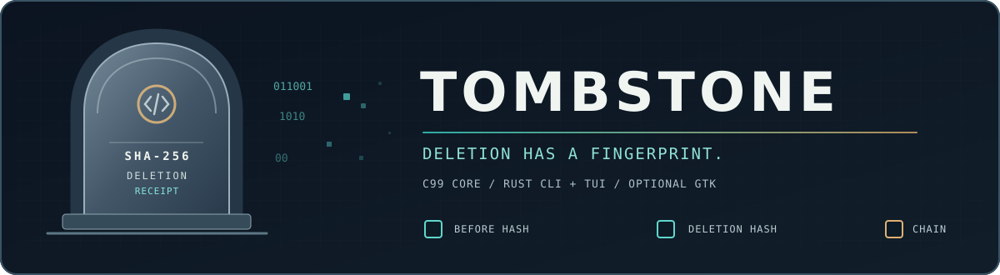

  

  <strong>Cryptographic deletion-event receipts without archiving deleted content.</strong> 
  <em>The data is gone from the receipt. The tombstone has a checksum.</em>

TOMBSTONE is a **C99-first** project for deterministic, independently checkable evidence about file transitions and, when removed bytes are actually witnessed, explicit deletion events.

**Implementation status:** Phase 0 documentation is established. Phase 1 provides a working **binary-safe C99 SHA-256 fingerprint library**, backed by OpenSSL EVP, with a minimal versioned public C ABI. **Deletion witnessing, receipts, strict JSON verification, Rust CLI/TUI and GTK are still planned.** The receipt v1 schema is a proposal, not a released protocol.

- **C99 logic:** SHA-256 fingerprinting implemented; deletion/receipt logic follows in later phases.
- **Rust CLI + TUI:** planned interfaces for agents and humans using the C99 core.
- **Optional GTK4:** future desktop GUI, not a requirement of the engine.
- **Separate documentation:** human prose in root Markdown and [docs](docs/INDEX.md), candidate machine contract in [machine/](machine/README.md).

## Build and verify the Phase 1 C99 library

Requires a C99 compiler, GNU Make, GNU ar, \`pkg-config\` and OpenSSL development headers/library (e.g. \`libssl-dev\` on Ubuntu).

\`\`\`sh
make                  # creates build/libtombstone.a
make test             # C99 vectors, binary bytes, streaming, error handling, public link
make reproducibility  # two independent identical static-library builds
make sanitizer-test   # ASan and UBSan
make docs-check       # original documentation/receipt fixture checks
\`\`\`

Public C ABI: [include/tombstone/fingerprint.h](include/tombstone/fingerprint.h). See the [API guide](docs/FINGERPRINT_API.md) and [getting started](GETTING_STARTED.md).

**Important:** A before/after SHA-256 comparison cannot reveal which bytes were deleted. Fingerprints are not proof of secure erasure or confidentiality; a hash of predictable data may be guessable.

Project instructions: [ARCHITECTURE.md](ARCHITECTURE.md), [INVARIANTS.md](INVARIANTS.md), [AGENTS.md](AGENTS.md), [ROADMAP.md](ROADMAP.md), [SECURITY.md](SECURITY.md).

Existing repository license: [Apache-2.0](LICENSE).
